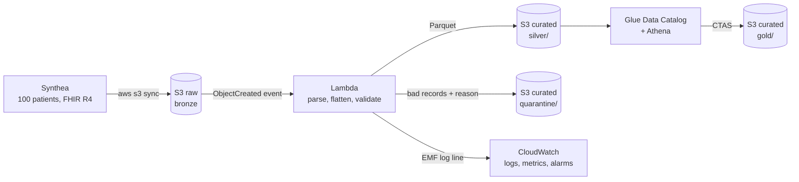

# VitalStream

[](https://github.com/joshuaannor/vitalstream/actions/workflows/ci.yml)

A serverless healthcare data pipeline on AWS. It ingests FHIR R4 patient records, validates them with data quality rules, and publishes SQL-queryable Parquet tables in a bronze / silver / gold layout.

> All data is synthetic, generated with [Synthea](https://github.com/synthetichealth/synthea). No real patient data is used.

## Architecture



| Layer | Where | What |
|---|---|---|
| Bronze | `s3://vitalstream-raw-<account>/fhir/` | Synthea bundles exactly as generated, never modified |
| Silver | `s3://vitalstream-curated-<account>/silver/` | 4 flat tables (patients, encounters, observations, conditions), partitioned by load date |
| Quarantine | `.../quarantine/` | Records that failed a rule, with the reason and the raw record |
| Gold | `.../gold/` | Question-shaped tables built by Athena CTAS |

## Highlights

- **Data quality with quarantine:** each record is checked (valid timestamps, subject and encounter references that resolve, required codes and values). Bad records are quarantined with a reason while the rest of the bundle loads; children of a rejected encounter are quarantined as orphans, so silver never has broken links.
- **Data minimization:** names, SSNs, passport/driver's license numbers and street addresses are dropped at the silver layer.
- **Idempotent loads:** output files are named by a hash of the source file, and silver views keep only the latest copy of each record, so re-processing never double-counts.
- **One SQL, two engines:** gold queries run in DuckDB locally and in Athena unchanged; a test blocks DuckDB-only syntax.
- **No crawlers:** Athena tables are generated from the same schemas as the Parquet files and use partition projection.
- **Reproducible data:** Synthea is pinned (with a checksum), seeded, and date-fixed, so every run produces byte-identical files.
- **Tested:** 69 pytest tests run in GitHub Actions against both pandas 2 and 3, plus cfn-lint on the SAM template.

## Stack

Python 3.12 (pandas, pyarrow) · SQL (Athena / Trino, DuckDB) · AWS S3, Lambda, Glue Data Catalog, Athena, CloudWatch, CloudTrail, IAM · AWS SAM · GitHub Actions · FHIR R4

## Project layout

```
template.yaml    AWS SAM: buckets, Lambda + role, alarms, Athena workgroup, CloudTrail
src/ingest/      Lambda code: FHIR parsing, data quality rules, Parquet writer, handler
src/analytics/   Athena catalog generation and local DuckDB runner
sql/gold/        Gold table queries (one SELECT per table)
sql/analytics/   Business questions on top of gold
sql/athena/      Generated Athena DDL + CTAS (do not edit by hand)
scripts/         Data generation, local runs, Athena runner, teardown
tests/           pytest (no data or AWS needed)
```

## Run it locally (no AWS)

Requires Java 17+ and Python 3.12. In each new PowerShell window:

```powershell
Set-ExecutionPolicy -Scope Process -ExecutionPolicy Bypass   # allows the venv script, this window only
.\.venv\Scripts\Activate.ps1
```

```powershell
powershell -ExecutionPolicy Bypass -File .\scripts\generate_synthea.ps1   # 107 bundles, ~45 s
python -m pytest                     # unit tests
python scripts/run_local.py          # bronze -> data/curated/silver + quarantine
python scripts/check_silver.py       # DuckDB checks: keys, joins, row counts
python scripts/build_gold.py         # silver -> gold
python scripts/run_queries.py        # business questions
python scripts/make_bad_bundles.py   # optional: broken bundles to see the quarantine work
```

## Deploy to AWS

```powershell
sam build
sam deploy                                                        # shows the change set and asks first
aws s3 sync data/raw/synthea/fhir s3://vitalstream-raw-<account>/fhir/   # triggers the Lambda per file
python scripts/run_athena.py                                      # tables, gold CTAS, questions
```

## Silver tables

| Table | Grain | Notes |
|---|---|---|
| patients | one per patient | identifiers and address dropped |
| encounters | one per visit | timestamps in UTC |
| observations | one per measurement | blood pressure and survey panels split into one row per component |
| conditions | one per diagnosis | `semantic_tag` separates disorders from findings |

## Gold tables and questions

| Gold table | What it answers | SQL skills |
|---|---|---|
| patient_summary | one row per patient: age, visits, chronic conditions, latest vitals | CTEs, LEFT JOIN, FILTER, ROW_NUMBER |
| encounters_monthly | visits per month and class, month-over-month change, YTD total | date_trunc, LAG, running SUM |
| condition_prevalence | how common each disorder is, ranked | COUNT DISTINCT, DENSE_RANK |
| a1c_trend | every HbA1c result vs the previous one, rolling average, clinical band | LAG, moving AVG, partitioned by year |

Example finding (Q4, diagnosis vs lab): of 6 patients diagnosed with type 2 diabetes, 3 now have a normal HbA1c, consistent with effective treatment; 31 of 34 prediabetic patients still test in the prediabetes range.

## Security

| Control | Implementation |
|---|---|
| No public data | S3 Block Public Access on every bucket; ACLs disabled (bucket owner enforced) |
| Encryption at rest | SSE-S3 on all buckets and Athena results |
| Encryption in transit | Bucket policies deny any request without TLS |
| Least privilege | The Lambda role can only read `raw/fhir/*`, write `curated/silver/*` and `curated/quarantine/*`, and write its own log group |
| Recoverability | Versioning on all buckets; old versions expire after 30 days |
| Audit | Multi-region CloudTrail trail with log file validation |
| Monitoring | Alarms on Lambda errors and on any quarantined record |
| Data minimization | Direct identifiers dropped before silver |

## Cost

Designed for the AWS Free plan: no NAT gateways, EKS, RDS, QuickSight, OpenSearch, Glue crawlers or customer-managed KMS keys. Lambda, S3, CloudWatch (6 custom metrics, 2 alarms) and the first CloudTrail trail fit in the free tier; Athena scans a few MB per run and the workgroup stops any query over 1 GB. Log retention is 14 days and Athena results expire after 7.

Tear everything down after a demo:

```powershell
python scripts/teardown.py    # empties the buckets, drops the Glue databases, deletes the stack
```

## Status

- [x] Phase 1: Setup
- [x] Phase 2: Generate synthetic data
- [x] Phase 3: Ingest pipeline (bronze to silver)
- [x] Phase 4: SQL analytics (gold)
- [ ] Phase 5: Security, IaC, CI, deploy
